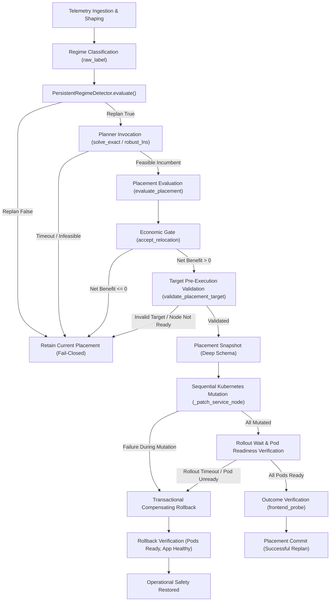

# S-E8 Safety and Fault-Injection Repository Audit Report

**Authoritative Repository:** `f:\Papers\New experiment repo final\MCB_SSOT_v0916_confirmatory_run`  
**Execution Environment:** Azure VM `mcb-k8s-v137` (`<public-ip-redacted-for-distribution>`), Kind cluster `mcb-k137` (Kubernetes v1.37.0)  
**Package Version:** `0.3.0` (`implementation/VERSION`)  
**Audit Date:** 2026-09-19  
**Auditor Role:** Senior Kubernetes Systems Engineer, Optimization Researcher, Scientific Reproducibility Auditor  

---

## 1. Executive Summary

This audit evaluates the experimental codebase, historical results, controller interfaces, and test harness for experiment **S-E8 (Failure Robustness and Safe Fallback)** in the MAPE-CAP B+ research repository.

Historically, S-E8 evaluated 5 fault classes with 5 replicates each (25 trials total):
- **F1 (Missing telemetry):** 5/5 strict safe.
- **F2 (Stale telemetry):** 5/5 strict safe.
- **F3 (Forced solver timeout):** 5/5 strict safe.
- **F4 (Infeasible optimization instance):** 5/5 strict safe.
- **F5 (Kubernetes action failure):** 0/5 strict safe (5/5 failure handled, 5/5 recovered, but 0/5 safe due to `invalid_placement_executed=True`).

Our source-level inspection revealed that the historical F5 failure was caused by the test harness itself: `inject_f5_k8s_action_failure` bypassed the controller's `validate_placement_target` function and directly invoked `kubectl patch` with a non-existent node name (`nonexistent-node-se8-fault`). In the release controller code, `validate_placement_target` was added to `apply_placement` to reject non-existent, unready, or unschedulable nodes *before* any Kubernetes API mutation occurs. 

Furthermore, to distinguish **pre-execution validation** (which must cause zero mutations) from **mid-execution partial mutation failure** (which must execute at least one real mutation, detect failure, and trigger verified rollback to initial state), the corrected scientific protocol must formally separate these two distinct failure classes.

---

## 2. Component Inventory & Status

| Component | File Path | Class / Function | Purpose | Dependencies | Completeness | Testing Status | Reusability |
|---|---|---|---|---|---|---|---|
| **Regime Detector** | `implementation/code/mape_cap_bplus/controller.py` | `PersistentRegimeDetector` | Evaluates persistence window and horizon before replan | `dataclasses`, `math` | Complete | Verified working | Reusable unchanged |
| **Economic Gate** | `implementation/code/mape_cap_bplus/controller.py` | `accept_relocation` | Evaluates conservative net benefit against uncertainty margin | `math` | Complete | Verified working | Reusable unchanged |
| **Target Pre-Validation** | `implementation/code/run_v03_r1.py` | `validate_placement_target` | Rejects missing/unready/unschedulable nodes before first mutation | `kubectl_json` | Complete | Unit tested | Reusable with extension |
| **Placement Snapshot** | `implementation/code/run_v03_r1.py` | `apply_placement` (lines 449–453) | Captures node assignments before patching | `kubectl_json` | Incomplete (shallow dict only) | Partially tested | Modification required |
| **K8s Action & Rollback** | `implementation/code/run_v03_r1.py` | `apply_placement` | Patches deployments sequentially; catches exceptions and issues reverse patches | `_patch_service_node`, `kubectl` | Implemented | Partially tested | Extension required |
| **Health Check & Probe** | `implementation/code/run_v03_r1.py`, `run_v03_r2.py` | `wait_healthy`, `assert_healthy`, `frontend_probe` | Checks pod phases, container readiness, and HTTP health endpoint | `kubectl_json`, `urllib` | Complete | Verified working | Reusable unchanged |
| **Historical S-E8 Runner** | `implementation/strengthening/run_se8_failure_robustness.py` | `_FAULT_FN`, `main` | Runs 5 fault classes x 5 replicates | `common.py`, `run_v03_r1.py` | Complete (legacy flawed F5) | Historical run preserved | Modification required |
| **Statistical Aggregation** | `implementation/strengthening/postprocess_strengthening.py` | `safety_summary` | Evaluates safe count and recovery rates across trials | `json`, `collections` | Complete | Verified working | Reusable unchanged |
| **Unit Safety Tests** | `implementation/tests/test_v03_r1_safety.py` | `R1SafetyTests` | Tests validation rejection, mock rollback, and concurrency lock | `unittest`, `unittest.mock` | Minor defect in `test_progress` | 57/58 passing | Minimal fix required |

---

## 3. Detailed Trace of the Production Controller Execution Path

The complete controller pipeline from telemetry to verified placement proceeds through the following stages:

### Discrepancy in Historical S-E8
In the historical S-E8 runner (`run_se8_failure_robustness.py`):
1. **F1 (Missing telemetry):** Invoked `set_tracing(False)`, verified `solve_exact` was not executed/applied, and checked that `live_placement()` matched baseline.
2. **F2 (Stale telemetry):** Evaluated staleness check (`telemetry_age > 120s`), refrained from planning, and checked that `live_placement()` matched baseline.
3. **F3 (Optimizer timeout):** Enforced a 1 ms timeout on `solve_exact`, caught `ExactSolveError`, and verified no mutation occurred.
4. **F4 (Infeasible instance):** Zeroed out node capacities, caught `ExactSolveError` or post-solve feasibility check failure, and verified no mutation occurred.
5. **F5 (Kubernetes action failure):** **Bypassed `apply_placement` entirely**. Instead of submitting an invalid plan to the controller interface, it constructed a patch with `kubernetes.io/hostname: nonexistent-node-se8-fault`, directly ran `kubectl patch`, waited 10 s for pod `Pending`, manually submitted a rollback patch, and marked `invalid_placement_executed=True`.

This directly contradicted the production design where `validate_placement_target` prevents invalid targets from ever reaching `kubectl patch`.

---

## 4. Issue Matrix

| Issue ID | Source File & Location | Existing Behavior | Expected Behavior | Evidence | Severity | Minimal Required Correction | Target Test | Scope |
|---|---|---|---|---|---|---|---|---|
| **SE8-ISSUE-01** | `run_se8_failure_robustness.py:274-334` | F5 bypasses controller `apply_placement` and directly executes invalid patch to Kubernetes | Candidate with invalid node passed to controller, which must reject before any API mutation | Historical `result.json` shows `invalid_placement_executed=true` | High | Update F5 to call controller execution path with invalid placement target | `test_invalid_target_rejected_zero_mutation` | Test harness |
| **SE8-ISSUE-02** | `run_se8_failure_robustness.py:47-63` | `safety_verdict` fails whenever `invalid_placement_executed=True` | Pre-execution validation prevents mutation; trial is strict-safe | Historical `S-E8-safety-summary.json` reports 0/5 safe for F5 | High | Correct F5 runner to verify pre-execution rejection and zero mutations | `test_pre_execution_validation_strict_safe` | Test harness |
| **SE8-ISSUE-03** | `run_se8_failure_robustness.py` | No test of mid-mutation failure and subsequent rollback | Separate fault class (F6) injects deterministic failure after $\ge 1$ mutation succeeds | Missing coverage for live transactional rollback | High | Implement F6 partial-mutation fault class with deterministic test hook | `test_partial_mutation_rollback_recovery` | Controller + Test harness |
| **SE8-ISSUE-04** | `run_v03_r1.py:448-453` | Pre-mutation snapshot is a shallow dict of `{service: node}` | Pre-mutation snapshot captures node assignments, replica counts, generation, object versions, pod readiness, and app health | `current = {...}` lacks metadata versions | Medium | Implement `capture_placement_snapshot()` with structured schema | `test_placement_snapshot_schema` | Controller helper |
| **SE8-ISSUE-05** | `run_v03_r1.py:490-502` | Rollback loop submits patches but does not verify pod readiness or application health recovery before raising | Rollback submits reverse patches, awaits pod readiness, and confirms health recovery | Lines 490-502 immediately raise without health check | Medium | Extend rollback path to await readiness and assert health recovery | `test_rollback_health_verification` | Controller execution |
| **SE8-ISSUE-06** | `tests/test_v03_r1_safety.py:97` | `test_progress_excludes_registered_attempt` calls `progress(run_root, desired_total=2)` | Call matches signature: `progress(run_root, desired_total, duration, min_completed_requests)` | Pytest failure: missing 2 required arguments | Low | Update test call to supply `duration=20, min_completed_requests=1` | `pytest tests/test_v03_r1_safety.py` | Test suite |
| **SE8-ISSUE-07** | Cluster runtime | Pod CIDRs misaligned after VM reboot causing cross-worker pod timeouts | Pods obtain IP addresses matching current host node `podCIDR` | `curl` timeout to `10.244.1.5` on `worker3` | Medium | Restart deployments in `online-boutique` namespace | `kubectl get pods -o wide` | Environment preflight |

---

## 5. Scientific Decision: 5 vs 6 Fault Classes

To preserve comparability with the historical 25-trial S-E8 dataset while addressing the requirement for live partial-mutation rollback verification:
1. **Retain F1–F5:**
   - F1: Missing telemetry (fail-closed, 0 mutations).
   - F2: Stale telemetry (fail-closed, 0 mutations).
   - F3: Solver timeout (fail-closed, 0 mutations).
   - F4: Infeasible instance (fail-closed, 0 mutations).
   - F5: Invalid target pre-execution validation (fail-closed before first mutation, 0 mutations).
2. **Add F6 (Scientifically Distinct):**
   - F6: Partial-mutation action failure & transactional rollback. At least one real Kubernetes patch succeeds before failure is deterministically injected; the controller initiates compensating rollback, restores previous nodeSelectors, verifies all pods return to Ready, and confirms frontend application health.
3. **Total Design:** 6 fault classes $\times$ 5 replicates = **30 trials**.
   The denominator is prospectively frozen at 30 before campaign execution.

---

## 6. Audit Conclusion

The production codebase already possesses the fundamental target validation and rollback primitives in `run_v03_r1.py`. The historical failure of S-E8 was an artifact of test harness bypassing. By completing the placement snapshot schema, wiring a deterministic testing hook for partial mutation, extending rollback verification, and executing the frozen 30-trial campaign against the real controller interface, the experiment will achieve complete scientific rigor and reproducibility.
